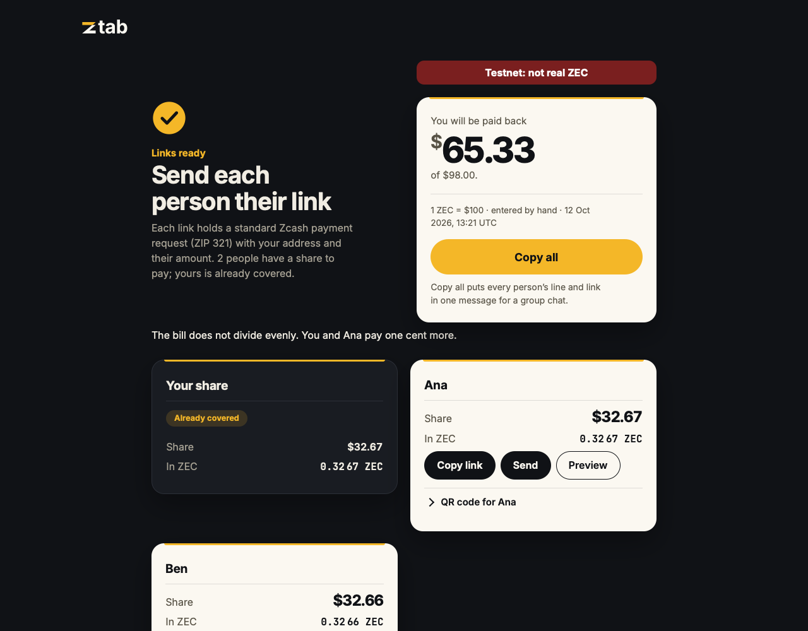
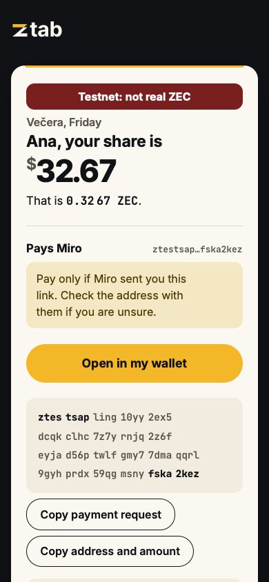

# Ztab

**Split the bill. Get paid back in Zcash.**

Built by **Sebrona**, led by **Miroslav Striško (Miro)**, with the AI assistants
Lagertha, Bjorn, Jarvis and Digitalac. [Team and responsibilities](#team).

[Open Ztab](https://ztab.sebrona.com/) ·
[Try the testnet sample](https://ztab.sebrona.com/?demo) ·
[Watch the product demo](https://youtu.be/ZxDVvR5dODA) ·
[Watch the pitch](https://youtu.be/vraYHLyCM7Q)

Ztab turns one bill into a payment request for each person. Enter the total in
fiat, split evenly, set amounts, or assign bill items and a proportional tip.
Share individual links or one Table QR for everyone. Each payer
sees their share, the recipient, and a note, then opens the request in a
compatible Zcash wallet or scans its QR code.

No Ztab account or app installation is needed. Ztab builds requests; your
wallet handles the payment.



<p align="center"></p>

*Screenshots use public testnet data and a manually entered example rate.
They show build `073abf9` with the Cut ribbon brand on 12 October 2026;
no wallet was opened and no funds were sent.*

## How it works

1. **Make:** press **Start a tab** and answer one step at a time: the bill,
   the people sharing it, the rate, then the organiser's receiving address.
   Set individual amounts, let Ztab split the remainder equally,
   or use **Split by item** and assign each item to the people who shared it.
   USD, EUR, GBP, CZK, PLN and CHF are supported. Enter a rate yourself or
   explicitly fetch one from Coinbase; if lookup fails, type a rate instead.
2. **Share:** use **Send** for the device's share sheet where supported, copy
   each person's link, or copy the messages for the group. **Show Table QR**
   gives everyone one code: scan it, choose your name, then check your pay page.
   Everyone with that group link can see the names and shares it contains.
   Your own share is already covered because you paid the original bill.
3. **Pay:** each link displays the exact ZEC amount, recipient and note. The
   payer checks them before opening a wallet. The rate's source and time stay
   visible; the amount is fixed when the tab is made.

The request is a standard ZIP-321 `zcash:` URI. Notes use the memo field for
addresses that can receive one. The engine checks requests before the app
shows them. Wallet handling of links, scans and memos varies: browser tests
and URI conformance tests do not establish compatibility with every wallet.

New requests carry a note such as “Dinner, Friday · Ana · $50.00 ·
10 Oct 2026 · Ztab”: bill label (or “Bill”), person, their share in the bill's
currency, and the UTC date the tab was made. The date comes from the link,
not the payer's clock. Notes stay within 512 UTF-8 bytes; transparent
recipients receive no memo. A wallet may not show or send the note.

New individual links use `#s3.…`; Table QR uses `#g2.…`. The current app
also reads `s1`, `s2` and `g1` links and rebuilds their original Tab notes.
Earlier app builds cannot read the new versions. The rename changes the
brand in new notes, not the receiving address or ZEC amount.

Ztab handles one bill at a time. It does not net debts across several bills,
exchange currencies, broadcast transactions, hold spending keys, or identify
who paid. An optional testnet check can find incoming payments with a viewing
key you provide; it does not identify their sender.
Check your wallet for incoming payments. The organiser's **Already covered**
badge refers to their own share of the bill they paid. A **VOID** badge
marks a link whose displayed amounts disagree; no payment action is offered
for it. Neither badge tracks a payment.

## From the bill to each share

**Split by item** accepts up to 100 items. Assign each one to one or more
people, then enter an optional tip/service percentage. Allocation uses cents,
with deterministic remainder handling, so the shares add up to the total.
People with no share get no payment link. Editing the bill removes stale
results until you make the links again.

**Paste bill lines** accepts text you type or copy, including text recognised
by your phone's own photo tools. Ztab does not scan photos or run OCR. It
suggests prices for simple lines such as `Wine 28.00`, keeps every nonempty
line visible, and selects nothing automatically. Review the editable names
and prices, select only the items you want, then add them. New items start
unassigned; existing items stay intact. Possible subtotal, tax and tip lines
remain visible with a caution. This is a cautious parser, not a promise that
receipt text is correct: check quantities, discounts, taxes and totals yourself.

**How each share adds up** shows each person's assigned item cents, tip/service
and total, using the same allocation that made the bill. Copy a breakdown
from the organiser's results if you want to explain it. Item descriptions
and this breakdown are not embedded in the payment links; sending the
copied text shares it with whoever receives it. Wallet fees are separate.

**Keep track of who has paid** opens the organiser's own page, with each
person's share, their request note and a checkbox. A tick is your own record;
Ztab cannot see payments on its own. The ticks live in the page's link, not
in browser storage. Copy the updated link or bookmark it to reopen that
record. Anyone with the link can see the whole tab. Identical names or
notes do not identify who sent a payment; check your wallet yourself.

**Paste a note from a payment in your wallet** compares its full text with
this tab's request notes, trimming only spaces at the ends. It proposes a
matching person; only your press on **Tick** changes the record. Identical
notes show separate choices by person number. The pasted text is cleared
after comparison and is never stored, sent or added to the link. A match
helps find a request; it proves neither who sent a payment, which request
was used, nor how much arrived. Check the transaction in your wallet.

**Check payments with a viewing key — testnet only** is a closed section on
the organiser's page. Opening it loads nothing. Only **Look for payments**
loads the scanner from this site and contacts ChainSafe's public testnet
server, `zcash-testnet.chainsafe.dev`. The page decrypts incoming notes on
your device, compares their full text and amounts with this tab, and proposes
people to tick. Nothing ticks automatically. An amount mismatch is shown;
a matching amount and note do not identify the sender or prove which request
was used. Your wallet remains the payment record.

A viewing key can reveal incoming payments to the wallet beyond this bill.
It cannot spend. The key stays in page memory: never sent, saved (including
with Remember), or put in a link. **Forget the key**, leaving this screen,
or closing the page clears it. **Stop looking** ends an in-flight scan;
when a key was already held, Stop retains it until you forget or leave.
Spending-key and recovery-phrase inputs are refused; never paste one.

The server sees your network address, the requested block ranges, and which
transactions the page fetches. It does not receive the key or decrypted
amounts/notes. This is not a trustless chain check: the page relies on the
server's answers. It reads unified viewing keys, looks back at most about
two days, and does not scan Sapling payments. It does not check that the key
belongs to this tab's receiving address. A search with no result does not
prove that no payment was made. Mainnet checking is unavailable.

The address badge names the kind the engine recognises: unified, shielded
Sapling, transparent or TEX. It does not promise a private payment or inspect
a unified address's receivers. Transparent addresses show the existing
public-amount warning.

**Address-format limit:** this build accepts the original unified-address
form (`u1` on mainnet, `utest1` on testnet). It does not yet accept the newer
`zu1`/`tu1` forms or their testnet counterparts. A valid newer-format address
currently receives the same generic error as an invalid address. Supporting
those forms requires their decoding and must-understand rules, not just a
new prefix. See [ZIP 316](https://zips.z.cash/zip-0316) and the
[observed wallet and browser limits](docs/wallet-checks.md#newer-unified-address-formats).

## Wallet request checks

The first checks predate the Ztab rename and used the earlier Tab note.
On 10 October 2026, the same public unified-address test request (0.02 ZEC,
note “Dinner · Ben”) displayed all three fields exactly in these Android
emulator entry paths:

| Wallet | Version | Verified path |
|---|---|---|
| Zingo | 2.0.24 (320) | Android URI intent, Advanced mode, device authentication |
| YWallet | 1.15.3 (578) | Android URI intent |
| Zkool | 6.32.0 (2377) | Complete request URI pasted into Recipient |

These are specific input-screen checks with fresh, unfunded wallets, not
a claim that every wallet or entry path works. No transaction was sent.
Physical phones, camera scans, the browser's wallet chooser and successful
payment are separate checks. See [versions and method](docs/wallet-checks.md).

In a separate physical-iPhone check on 10 October, the organiser reported
that Zodl showed the shielded address, amount and note, including the fuller
note format. The camera opened Zodl, which requested another scan inside
the app. Zodl's version was not recorded; this was request entry, not evidence
of a completed payment or of an incoming memo.

On 11 October, **Open in my wallet** from Ztab build `950aa3a` in Chrome on
an Android emulator opened Zingo 2.0.24 Advanced mode with the exact address,
amount and full **· Ztab** note. The wallet was unfunded; no payment was sent.

In a separate **testnet** check on build `4d20ead`, Zingo PC 2.0.26 sent
0.00804690 TAZ between two disposable wallets. The receiving wallet showed
the amount, the full Ztab note and seven confirmations. This is one verified
testnet path, not a real-user bill or a promise about other wallets. See
[the exact versions, notes and limits](docs/wallet-checks.md).

## Privacy and remembering

The app has no backend or bill database. Each payer's request and its display
information are encoded in the URL fragment, after `#`. Browsers do not send
that fragment in the HTTP request for the page. **The link is not encrypted:**
anyone who receives it can read the information it contains, including the
receiving address, names, amount and note. A forwarded link does not prove
who created it; verify the recipient before paying.

Remembering is off by default. If you opt in and make the links, Ztab keeps
only your receiving address and names in this browser's local storage. It
does not save the bill, amounts, label or links. The remembered address is
shown with a reminder to check it. **Forget them**, or switching remembering
off, removes the saved record; storage failures are reported rather than
presented as success. Anyone using this browser profile can see saved data.
Opening a payment, Table QR or organiser link does not read or write this record.

The app serves its script, stylesheet and fonts from its own origin. Fetching
a rate contacts Coinbase without credentials or a referrer and sends no bill
data; Coinbase can see the request from your connection. The hosting provider
receives ordinary page requests and may receive browser network-error reports.
The optional viewing-key check also contacts the named public Zcash server,
only after you press Look for payments, with the disclosure and limits above.
Ordinary visits load only this site's files; the scanner and its WebAssembly
module load only when that check is requested.

## Run locally

Use Node.js 24 and npm. Development tests were run with Node.js 24.17.0.
Run them from the repository root:

```sh
npm ci --prefix packages/engine
npm ci --prefix apps/web
npm run dev --prefix apps/web
```

Vite prints the local address. For the static production build:

```sh
npm run build --prefix apps/web
npm run preview --prefix apps/web
```

Deploy the contents of `apps/web/dist` to a static host. No application server,
API key, wallet connection or environment secret is required.

## Tests

```sh
npm test --prefix apps/web
npm run typecheck --prefix packages/engine
```

The engine also runs against ZecDev's ZIP-321 conformance vectors. Check out
the pinned corpus next to this repository, then pass an **absolute** path:

```sh
git clone https://github.com/zecdev/zcash-zip321-test-vectors.git ../zcash-zip321-test-vectors
git -C ../zcash-zip321-test-vectors checkout f76de74ac483b9c75dbbfa1ffc40ca170a0892be
ZIP321_CORPUS="$(cd ../zcash-zip321-test-vectors && pwd)" npm test --prefix packages/engine
```

At `b4cf5fe`: **143 engine tests: 137 passed, six skipped, zero failed;
109 web tests passed.** At the branded organiser/address-badge build
`950aa3a`, **120 web tests passed**. Owner review of the manual matcher at
`b06a9a6` repeated **120 web tests** and **143 engine tests: 137 passed, six
skipped, zero failed**, plus the organiser and matcher browser regressions
in Chromium and Playwright WebKit; no engine file changed. At the reviewed
viewing-key build `49e6446`, **148 web tests passed**, alongside the finder
browser regressions in both engines. Navigation, Stop/Forget, late replies
and synthetic persisted-page lifecycle tests leave keys forgotten and no
continuing server calls after leaving. A real browser cache restore was not
observed in that harness. The engine and scanner module were unchanged in
the final lifecycle fix. The six skips are canonical-URI builder checks for
vectors outside the single-payment-with-an-amount builder's scope. Without
`ZIP321_CORPUS`, the external corpus suite is skipped. See [vectors](vectors/README.md).

Coverage includes exact split arithmetic against an independent oracle,
rounding, URI parsing and building, share-link consistency, rate parsing and
Remember's denied reads, writes and removals, the six-currency allowlist,
field/index error routing, deterministic fuller notes, legacy-link note
preservation, Table QR validation, pasted-line review, exact item breakdowns, organiser
link ticks by position, address badges, and exact manual note matching with
duplicate choices, explicit confirmation and no persistence of pasted text.
Production-build browser checks
have also been run in Chromium and Playwright WebKit. These are not a claim
that real Safari, physical phone wallets or payments have passed.

The optional browser scripts in `apps/web/test/browser/` run against a local
production preview. With Playwright and its Chromium/WebKit browsers already
installed in your development environment:

```sh
# In one terminal:
npm run preview --prefix apps/web -- --host 127.0.0.1 --port 8764
# In another; set PLAYWRIGHT_MODULE to that installation's index.mjs if needed:
node apps/web/test/browser/share.mjs
node apps/web/test/browser/currencies.mjs
node apps/web/test/browser/stamps.mjs
node apps/web/test/browser/field-errors.mjs
node apps/web/test/browser/fuller-memo.mjs
node apps/web/test/browser/organiser.mjs
node apps/web/test/browser/note-match.mjs
TAB_ORIGIN=http://127.0.0.1:8764 node apps/web/test/browser/payment-finder.mjs
```

The sharing script simulates the native share/clipboard boundary, and the
currency script supplies controlled rate responses. Neither establishes a
real share-sheet delivery or future rate-service availability. The finder
regression uses a synthetic cryptographic vector and a stand-in chain server.
Separately, the built finder located one of our own testnet payments in
Chromium and Playwright WebKit, with its exact amount and note. This is
testnet evidence, not a mainnet, real-user or physical-phone check.

## Reuse the request engine

[`packages/engine`](packages/engine/src/index.ts) is a separate TypeScript
module with no DOM, network, storage, clock or wallet dependency. It exposes:

| API | Purpose |
|---|---|
| `split` | Divide a bill using an explicit rate and deterministic rounding; return per-person requests |
| `buildUri`, `parseUri` | Build a single-payment ZIP-321 URI and parse payment requests |
| `checkAddress`, `canReceiveMemo` | Check address structure/network and memo capability |
| `encodeShare`, `decodeShare` | Encode a payer's link and validate it on opening |

The engine uses integer arithmetic for monetary allocation. Its rounding
rule and which shares receive remainders are returned with the result.
The web app supplies the exchange rate; the engine never fetches one.

The package is currently consumed from source within this repository, not
published to npm. See the [input and result types](packages/engine/src/types.ts)
and [executable examples](packages/engine/test/split.test.ts) to integrate it.

## Team

Ztab is a Sebrona project led by Miroslav Striško (Miro), Sebrona's CEO.
Miro sets the product direction, makes the release decisions and is the
human founder behind the submission.

The team uses named AI assistants under his direction:

| Contributor | Work on Ztab |
|---|---|
| Lagertha | App development, browser checks and code review |
| Bjorn | Product specification, claims review and pitch writing |
| Jarvis | Engineering, wallet checks, code review and video assembly |
| Digitalac | Submission preparation and browser coordination |

These names identify AI assistants, not additional human founders. The
videos use synthetic narration. Miro remains responsible for the project
and its public claims.

## Submission record

The submitted source snapshot is
[`df10bff`](https://github.com/skazistp-cpu/ztab/tree/df10bff51047978db5f753e47a2625ce624bd0cc).
The demo and pitch linked above are the submitted videos. Documentation
clarifications dated 13 October 2026 do not change that source snapshot.

**Demo clarification:** the narration's “137 passed” refers to the combined
engine test run: 70 Ztab engine tests and 67 ZIP 321 conformance-vector tests.
It does not mean 137 conformance vectors. Six additional checks were skipped.
The demonstrated payments use testnet between our own wallets.

## Repository and licence

| Path | Contents |
|---|---|
| `apps/web` | Static TypeScript/Vite app and web tests |
| `packages/engine` | Reusable payment-request engine and its tests |
| `packages/finder` | Rust source and pinned dependencies for the optional testnet scanner |
| `vectors` | Corpus instructions and additional invalid-amount fixtures |
| `docs/images` | Screenshots and their provenance |

[MIT](LICENSE), Copyright 2026 Sebrona. Bundled fonts retain their own
licences: [Inter](apps/web/src/fonts/Inter-LICENSE.txt) and
[JetBrains Mono](apps/web/src/fonts/JetBrainsMono-LICENSE.txt).

Built on ZIP 321 and ZecDev's MIT-licensed conformance vectors by Pacu, with
the `zip321` crate in librustzcash as a reference. Ztab uses `@noble/hashes`,
`@scure/base` and `qrcode-generator`; dependency versions are in the committed
lockfiles.
